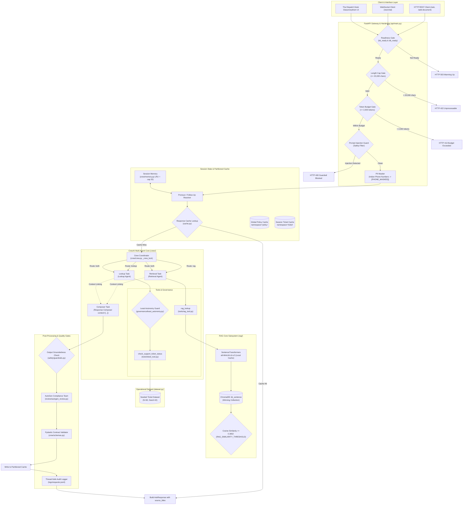

# System Architecture Specification: Ola Domain Support Agent

**System Name:** Ola Domain Support Agent (`ola-support-agent`)  
**Domain Track:** Business Operations & Customer Support (Ola)  
**Target Execution Environment:** Zero-network, offline-capable environment operating under deterministic `MOCK_LLM`  

---

## 1. Executive Summary & Design Principles

### 1.1 Purpose

The **Ola Domain Support Agent** is an enterprise customer and operations support platform engineered to provide deterministic, grounded, and policy-compliant assistance to riders, drivers, and internal operations staff. The agent serves two distinct operational intents:

1. **Policy Queries:** Answering operational, regulatory, and procedural questions (e.g., ticket priority tiers, SLA timelines, refund criteria) grounded strictly in an internal knowledge base via Retrieval-Augmented Generation (RAG).
2. **Ticket Status Inquiries:** Looking up real-time ticket records (e.g., status, resolution time, escalation risk) against a validated synthetic operational dataset using structured tool invocation.
3. **Hybrid Inquiries:** Seamlessly composing responses that combine policy context and specific ticket details (route `"both"`).

### 1.2 Core Architectural Principles

```text
+-------------------------------------------------------------------------------+
|                             DESIGN PILLARS                                    |
+-----------------------+-------------------------------+-----------------------+
|   ZERO-TRUST SEC &    |        DETERMINISTIC          |    MULTI-TIERED       |
|      GOVERNANCE       |        REPRODUCIBILITY        |    QUALITY GATES      |
| * Least Autonomy Tool | * Seeded Synthetic Data       | * Calibrated Cosine   |
|   Binding             | * Offline Embeddings Cache    |   RAG Thresholding    |
| * Token Budget Caps   | * Rule-Based MockLLM ReAct    |   (tau = 0.3652)      |
| * Indian PII Masking  | * Zero External Network Calls | * Pydantic Validation |
| * Masked JSON-L Logs  | * Deterministic Eval Scoring  | * Dual-Agent Autogen  |
| * Partitioned Cache   | * Chained Sequential Tasks    |   Compliance Review   |
+-----------------------+-------------------------------+-----------------------+
```

1. **Production Governance & Least Autonomy:** Tools are bound to specific agent roles. The runtime authorization guard (`ToolAccessControl.verify_agent_tool_access`) enforces that only the `Lookup Agent` may execute ticket lookups; any unauthorized role (including the Composer) raises `PermissionError`.
2. **Deterministic Reproducibility:** Every execution path—synthetic data generation (`seed=42`), embedding indexing, agent routing, tool execution, and benchmark scoring—is deterministic without network or paid API dependencies.
3. **Calibrated Decision Thresholds:**
   - **RAG Similarity Threshold (`RAG_SIMILARITY_THRESHOLD = 0.3652`)**: Empirically calibrated cosine similarity cutoff separating in-scope policy queries from out-of-scope inquiries. Queries falling below 0.3652 safely trigger deterministic refusal without hallucination.
   - **Escalation Risk Threshold (`ESCALATION_RISK_THRESHOLD = 0.4400`)**: Empirical 80th-percentile cutoff on composite ticket risk scores ($0.6 \times \text{escalated} + 0.4 \times \text{age\_ratio}$), isolating high-risk cases for proactive supervisor intervention.
4. **Resilient Multi-Agent Consensus:** Single-agent hallucinations are mitigated through a two-stage pipeline: a CrewAI task execution team for drafting followed by an independent AutoGen review team (`PolicyComplianceReviewer` and `FinalEditor`) enforcing policy alignment before delivery.

---

## 2. End-to-End Multi-Agent Architecture Diagram



---

## 3. Subsystem Breakdown

### 3.1 Gateway & Input Hardening (`api/main.py`)
- **Strict Verification Order**: Readiness Check (503) $\rightarrow$ Character Length Cap (422) $\rightarrow$ Token Budget Enforcement (413) $\rightarrow$ Prompt Injection Defense (400) $\rightarrow$ PII Masking.
- **Async Event Loop Protection**: CPU-bound CrewAI execution and AutoGen multi-turn review run in background worker threads via `anyio.to_thread.run_sync()`.
- **Administrative Security**: Privileged endpoints (`/add-document`, `/clear-cache`) require the `X-Admin-Token` header.
- **Document Ingestion Hardening**: Titles validated against `^[A-Za-z0-9_-]{1,64}$`, trailing `.md` stripped, path traversal attempts rejected with HTTP 422.

### 3.2 Session Memory & Partitioned Cache (`crew/memory.py`, `cache.py`)
- **Pre-Cache Pronoun Resolution**: Follow-up questions (e.g., "what about its SLA?") are rewritten with historical entity context *before* cache lookup.
- **Partitioned Namespaces**:
  - `policy`: History-free policy questions are cached globally across sessions.
  - `ticket`: Queries containing ticket IDs or resolved follow-ups are scoped strictly to `ticket:{session_id}:{norm_query}`.
- **Memory Hygiene**: Sessions capped at `MAX_MESSAGES_PER_SESSION = 20`; active sessions managed with LRU eviction (`MAX_SESSIONS = 100`).

### 3.3 CrewAI Multi-Agent Core (`crew/crew.py`, `crew/agents.py`, `crew/mock_llm.py`)
- **Role Separation**:
  - `Retrieval Agent`: Executes policy retrieval through `rag_lookup`.
  - `Lookup Agent`: Queries operational ticket records through `check_support_ticket_status`.
  - `Response Composer`: Zero tools; synthesizes structured customer responses from task context.
- **Context Chaining**: Sequential Crew tasks link upstream outputs (`context=[retrieval_task, lookup_task]`), eliminating duplicate tool calls during composition.
- **Thread Safety**: Request execution protected by coordinator re-entrancy locks (`_crew_lock`).

### 3.4 Runtime Governance & Least Autonomy (`governance/least_autonomy.py`)
- Active agent role tracked via thread-local context (`CURRENT_CALLER_ROLE`).
- Attempted tool calls from unauthorized agents raise `PermissionError`.

### 3.5 Grounded RAG Subsystem (`rag/index.py`, `rag/generate.py`, `rag/calibrate.py`)
- **Vector Collections**: Pure sentence-based chunking indexed in `kb_sentence` with cosine distance metric.
- **Empirical Groundedness Threshold**: Cutoff calibrated at `RAG_SIMILARITY_THRESHOLD = 0.3652`. Queries falling below this threshold trigger the exact fallback:
  `"I don't know based on the available policy documents."`
- **Escalation Risk Threshold**: Distinct operational cutoff at `ESCALATION_RISK_THRESHOLD = 0.4400` used in `tools/ticket_tool.py` for supervisor intervention recommendations.

### 3.6 AutoGen Secondary Review (`review/autogen_review.py`)
- Two-agent consensus team (`PolicyComplianceReviewer` and `FinalEditor`).
- Validates drafts against retrieved context and ticket data before delivery.

---

## 4. Response Contract & Client Display

Every successful query returns the unified `AskResponse` schema:
```json
{
  "answer": "...",
  "route": "rag | lookup | both | direct",
  "sources": ["sla_by_severity"],
  "source_titles": ["Service Level Agreement (SLA) Policy"],
  "ticket": { ... },
  "grounded": true,
  "escalation_recommended": false,
  "trace_id": "...",
  "latency_ms": 12.34,
  "cache_hit": false,
  "review_status": { "approved": true, ... }
}
```
Client UI displays `source_titles` in the sources pill and HUD panel for clean human readability.

