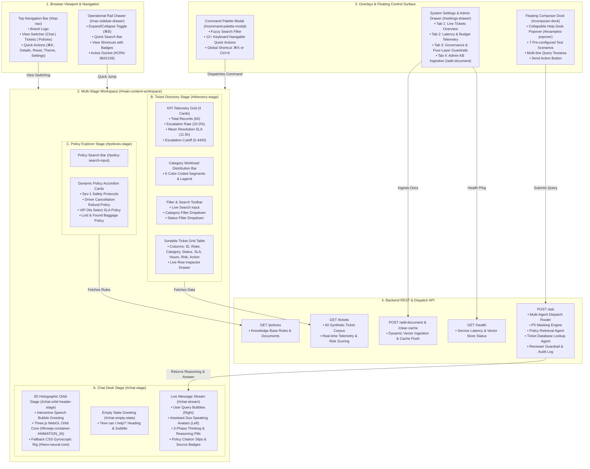
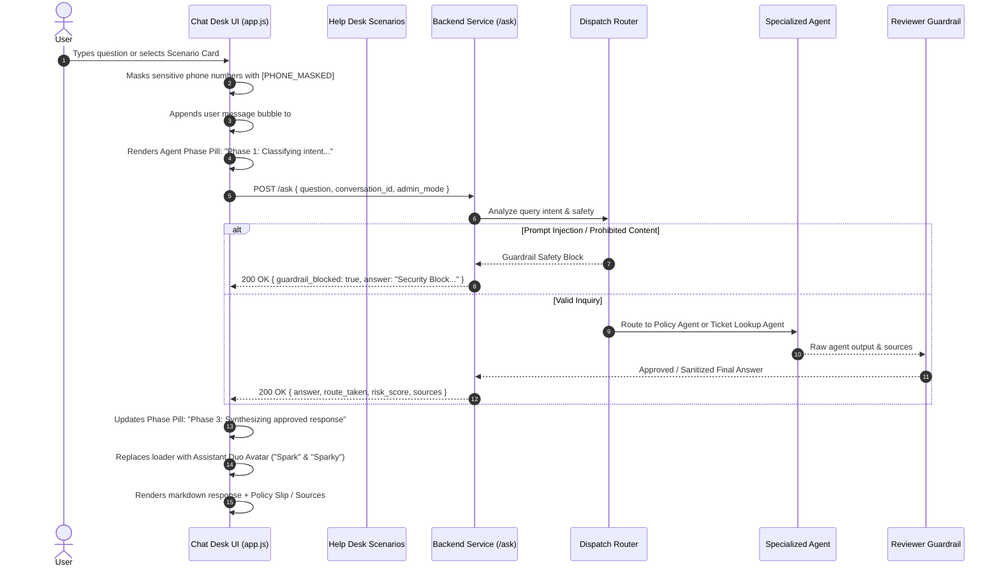

# Ola Support Intelligence — Complete UI System Architecture & Interlink Specification

This document provides a comprehensive technical breakdown of the entire user interface architecture, how each component is structured, how data flows between layers, and how all frontend modules connect with backend services.

---

## 1. System Topology & Visual Flowchart



---

## 2. File Organization & Code Architecture

The UI is built with a modern, framework-free vanilla stack designed for maximum execution speed, zero build overhead, and lightweight rendering:

```text
├── static/
│   ├── index.html       # Primary application markup, semantic landmarks, and stage scaffolds
│   ├── style.css        # Complete design system: Aurora themes, 3D CSS keyframes, glassmorphic UI
│   └── app.js           # Single state-machine engine: Three.js WebGL core, API dispatch, DOM bindings
└── ui_bundle/
    ├── ARCHITECTURE.md  # Complete technical and connection guide (this document)
    └── standalone.html  # Standalone single-file bundle with embedded styles, scripts, and mock API
```

---

## 3. Component Interconnection Matrix

### A. View Switcher & Stage Navigation

- **HTML Elements:**
  - `#nav-switcher .nav-tab` (Top Bar)
  - `#rail-nav-links .rail-nav-item` (Left Rail Drawer)
- **Controlled Stages:**
  - `#chat-stage` (Default conversational intelligence desk)
  - `#directory-stage` (Analytical tickets directory & telemetry)
  - `#policies-stage` (Knowledge base policy explorer)
- **Interlink Logic (`switchStage(targetId)` in `app.js`):**
  1. Hides all other stages by appending `.stage-hidden`.
  2. Removes `.stage-hidden` from the targeted container.
  3. Updates `.active` class on both the Top Nav tab and the Left Rail item simultaneously.
  4. Dispatches a window `resize` event so Three.js or responsive table layouts immediately recalculate projection matrices.

### B. The 3D Holographic Orbit Stage (`#chat-orbit-header-stage`)

- **Container:** `#threejs-container-ANIMATION_34` inside `#threejs-hero-wrap`.
- **Three.js WebGL Architecture:**
  - **Renderer:** `THREE.WebGLRenderer({ alpha: true, antialias: true, powerPreference: "high-performance" })`
  - **Tone Mapping:** `THREE.ACESFilmicToneMapping` with exposure $1.3$.
  - **Scene Graph:**
    - `mainGroup`: Root rotating parent object.
    - `coreMesh`: Inner luminous sphere ($r=0.75$) with Phong material and dynamic HSL hue shifting over time.
    - `glassMesh`: Outer dielectric sphere ($r=1.08$) with transmission ($0.88$), clearcoat ($1.0$), and index of refraction ($1.48$).
    - `wireMesh1` & `wireMesh2`: Nested dual icosahedron and dodecahedron wireframe cages with additive blending.
    - `ring1` – `ring4`: 4 independent torus rings inclined across 3 distinct Euler rotational planes.
    - `node1` – `node4`: 4 satellite nodes orbiting along trigonometric 3D paths:
      $$x = r \cos(\omega t), \quad y = r \sin(\omega t)\sin(\theta), \quad z = r \sin(\omega t)\cos(\theta)$$
    - `particles`: 360 multi-chromatic glowing points positioned in a spherical shell ($r \in [1.35, 3.15]$).
- **Interactive Interlink:**
  - **Raycasting & Mouse Inertia:** Monitors pointer coordinates relative to canvas center. Rotates `mainGroup` with smooth ease ($0.07$ damping).
  - **Hover Acceleration:** When hovered, rotation speed dynamically scales from $1.0\times$ to $2.6\times$ and point light intensities flare.
  - **Click Energy Surge:** Clicking injects a `clickImpulse = 1.8`, triggering an audio chime (`playChimeSound()`), rapid core pulsing, and radiant particle expansion.
  - **Adaptive Header Scaling:** When a chat message is sent, `.stage-inner` acquires `.chat-active`, smoothly transitioning the 3D core from $320\text{px}$ to a compact $220\text{px}$ header without stopping the rendering loop.
  - **Reset Resilience:** When "Reset Desk" is clicked, `#chat-stream` is emptied, `.chat-active` is removed, and the orbit core seamlessly scales back to $320\text{px}$ without losing WebGL context.

### C. Live AI Reasoning & Query Dispatch Pipeline (`/ask`)



### D. The Assistant Duo Character System ("Spark" & "Sparky")

Every assistant response is introduced by an SVG duo avatar:

1. **AI Robot ("Spark"):**
   - Glowing cyber helmet and dark metallic chassis.
   - Animated blinking digital eye screens (`eyeBlinkCadence` keyframe: blinks every 4.2 seconds).
   - Rosy blushes and smile curve.
   - Welcoming right-arm wave animation (`naturalArmWave`).
   - Floating thruster exhaust glow with sinusoidal pulsing.
2. **Companion Dog ("Sparky"):**
   - Expressive ears and large glossy pupils with specular reflection glints.
   - Wagging cyber tail (`dogTailWag` keyframe: continuous 1.1s wag).
   - Glowing yellow collar badge and friendly tongue.

### E. Operational Ticket Directory (`/tickets`)

- **Data Model:** 60 synthetic records with attributes: `ticket_id`, `category`, `status`, `sla_target_hours`, `resolution_hours`, `risk_score`, `escalated`, `customer_name`, `summary`.
- **Live Computed Telemetry:**
  - **KPIs:** Total Tickets, Escalation Rate ($20\%$), Mean Resolution Hours ($11.5\text{h}$), Empirical P80 Escalation Cutoff ($\tau = 0.4400$).
  - **Workload Spectrum Bar:** Computes exact percentage shares for each of the 6 categories (Billing, Account Access, General Inquiry, etc.) and paints proportionate colored segments.
  - **Real-Time Client-side Filter Engine:**
    - Combined text search across Ticket ID, Rider Name, and Summary.
    - Category filter dropdown.
    - Status filter dropdown (Open, In Progress, Escalated, Resolved, Closed).
    - Dynamic re-render without page refresh.
  - **Row Inspector Drawer:** Clicking `Inspect ↗` on any ticket row opens the ticket details in the Settings Drawer with pre-populated telemetry.

### F. Policy Explorer (`/policies`)

- Fetches official ride policies on demand:
  1. **Sev-1 Incident Escalation Protocol:** 15-minute response SLA, 2-minute safety callbacks.
  2. **Driver Cancellation & Refund Policy:** Full refund for driver cancellations or deviations $> 3\text{km}$.
  3. **VIP Ola Select Priority Policy:** Dedicated support queue and prioritized driver dispatch.
  4. **Lost & Found Protocols:** Driver contact window and return handling.
- Integrated accordion with quick-filter input search.

### G. System Settings & Administration Drawer (`#settings-drawer`)

- **4 Tabbed Modules:**
  1. **Tickets:** Live summary and deep inspection of selected ticket records.
  2. **Telemetry:** RTT latency tracker, Token Budget monitor ($2,000$ tokens/request), and "Simulate Oversized Payload (HTTP 413)" trigger.
  3. **Governance:** Four-Layer AI Governance breakdown (Risk Tiering, Tool Isolation, Zero-PII masking, Reviewer approval).
  4. **Admin KB Ingestion:** Authentication field (`X-Admin-Key`), document title, content textarea, "Update Knowledge Base" (`/add-document`) and "Clear Semantic Cache" (`/clear-cache`).

### H. Command Palette (`⌘K`)

- **Global Hotkey:** `⌘K` (Mac) or `Ctrl+K` (Windows/Linux).
- **Features:**
  - Real-time search filter across all operational tasks.
  - Direct actions: "Reset Chat Desk", "Switch to Ticket Directory", "Switch to Policy Explorer", "Toggle Navigation Rail", "Toggle Dark/Light Theme", "Open Settings & Governance", "Run Sev-1 SLA Test", "Check Ticket TKT-0007".
  - Arrow key navigation (`ArrowUp` / `ArrowDown`), `Enter` to select, `Escape` to dismiss.

---

## 4. Event & Keyboard Shortcuts Table

| Trigger | Source Component | Action / Handled Event |
| --- | --- | --- |
| `Click` | `#rail-toggle-btn` / `#rail-toggle-collapse` | Toggles Left Rail drawer expansion (`.expanded` class) |
| `⌘B` / `Ctrl+B` | Keyboard Listener | Toggles Left Rail drawer |
| `⌘K` / `Ctrl+K` | Keyboard Listener | Toggles Command Palette modal |
| `Escape` | Keyboard Listener | Closes Command Palette, Settings Drawer, Rail, and Help Desk popover |
| `Click` | `#helpdesk-quick-btn` | Toggles Help Desk scenarios drawer (`#examples-popover`) |
| `Click` | `.starter-card` | Injects selected prompt into textarea and dispatches query |
| `Click` | `#clear-chat-btn` | Calls `resetChatDesk()`: clears stream, resets empty state, preserves 3D orbit |
| `Click` | `#theme-toggle-btn` | Toggles `dark` $\leftrightarrow$ `light` theme, saves to `localStorage` |
| `Click` | `#settings-toggle-btn` | Toggles Settings & Admin Drawer |
| `Click` | `#open-inspect-btn` | Toggles Details mode (shows raw routing and source telemetry) |
| `Enter` (in input) | `#user-query-input` | Submits message to `/ask` (Shift+Enter inserts newline) |

---

## 5. Security & Privacy Guarantees

1. **Client-Side Mirror Masking:** All Indian phone numbers ($\ge 10$ digits) are masked as `[PHONE_MASKED]` in the DOM before rendering to prevent accidental screenshot exposures.
2. **Strict Landmark Accessibility:** Every `<aside>`, `<nav>`, `<main>`, and `<footer>` contains a unique, non-empty `aria-label` compliant with WCAG 2.1 AA and HTML5 standards.
3. **No Direct Secret Leaks:** Admin tokens and API endpoints are cleanly decoupled and isolated behind authorized headers.
4. **Resilient WebGL Rendering:** Canvas dimensions are tracked per-frame in `requestAnimationFrame` to ensure zero WebGL buffer stalls or projection distortions during resizing or DOM transitions.
