# Ola Support Intelligence — Complete System Architecture Specification

This document provides the authoritative, end-to-end technical architecture of the entire **Ola Support Intelligence Platform**, spanning the client-side 3D spatial user interface, the multi-agent orchestration engine, the vector RAG knowledge retrieval subsystem, the operational ticket telemetry core, the four-layer security guardrail defense, and the compliance governance pipeline.

---

## 1. Master System Topology & End-to-End Architecture

```mermaid
flowchart TD
    subgraph ClientLayer ["1. Spatial Client & Interface Surface (static/ & ui_bundle/)"]
        WebConsole["Spatial Intelligence Desk (HTML5 / CSS / Three.js)<br/>• 3D Holographic Orbit Stage (#chat-orbit-header-stage)<br/>• Assistant Duo Speaking Rig ('Spark' & 'Sparky' 🐾)<br/>• 3-Phase Live Reasoning & Thinking Badges<br/>• Command Palette (⌘K) & Left Operational Rail (⌘B)"]
    end

    subgraph GatewayLayer ["2. API Gateway & Hardening Layer (api/main.py)"]
        ReadinessGate{"Readiness Gate<br/>(kb_ready & db_ready)"}
        CharCapGate{"Payload Cap Gate<br/>(&le; 20,000 chars)"}
        BudgetGate{"Token Budget Gate<br/>(&le; 2,000 tokens/request)"}
        PIIMasker["Client & Server PII Masker<br/>(Indian Phone Numbers &rarr; [PHONE_MASKED])"]
        InjectionGuard{"Prompt Injection Guard<br/>(Adversarial Pattern Detection)"}
    end

    subgraph SessionCacheLayer ["3. State Management & Semantic Cache (crew/memory.py & rag/cache.py)"]
        SessionMem["Session LRU Memory<br/>(Sliding window cap 20 turns)"]
        ContextResolver["Context & Pronoun Resolver<br/>(Infers ticket ID & follow-up context)"]
        CacheCheck{"Partitioned Cache Gate<br/>(Semantic Cosine Sim &ge; 0.95)"}
        PolicyCache[("Global Policy Cache<br/>namespace='policy'")]
        TicketCache[("Session Ticket Cache<br/>namespace='ticket'")]
    end

    subgraph CrewLayer ["4. Multi-Agent Orchestration Core (crew/ & crew/router.py)"]
        RouterAgent["Intent Classification Router<br/>• 'policy' (RAG Search)<br/>• 'ticket_lookup' (Database Tool)<br/>• 'both' (Hybrid Synthesis)<br/>• 'unclear' (Clarification Prompt)"]
        
        subgraph AgentWorkers ["Specialized Worker Team"]
            RetrievalAgent["Policy Retrieval Agent<br/>(Bound strictly to RAG Lookup)"]
            LookupAgent["Ticket Database Agent<br/>(Bound strictly to Ticket Tool)"]
            ComposerAgent["Response Composer Agent<br/>(Contextual Synthesis & Policy Slips)"]
        end

        subgraph ToolGovernance ["Runtime Tool Access Control"]
            LeastAutonomyGuard{"Least Autonomy Guard<br/>(ToolAccessControl.verify)"}
            RAGTool["rag_lookup tool<br/>(tools/rag_tool.py)"]
            TicketTool["check_support_ticket_status<br/>(tools/ticket_tool.py)"]
        end
    end

    subgraph KnowledgeLayer ["5. RAG & Vector Retrieval Subsystem (rag/ & kb/)"]
        ChromaStore[("ChromaDB Vector Store<br/>Sentence Chunks Collection")]
        LocalEmbed["SentenceTransformers<br/>all-MiniLM-L6-v2 Embeddings"]
        CalibratedRAG{"Calibrated Cosine Cutoff<br/>(&tau; = 0.3652)"}
        KBMarkdown["Official Policy Docs<br/>• Cancellation Refunds<br/>• Sev-1 Safety Protocols<br/>• VIP Ola Select SLAs<br/>• Lost & Found Baggage"]
    end

    subgraph DataLayer ["6. Operational Dataset & Risk Engine (data/)"]
        SyntheticDB[("Seeded Ticket Database<br/>(N=60 Records, Seed=42)")]
        RiskModel["Predictive Escalation Risk Model<br/>risk = 0.6 * escalated + 0.4 * age_ratio<br/>(&tau; = 0.4400 Cutoff)"]
    end

    subgraph ReviewLayer ["7. Post-Processing & Quality Gates (review/ & governance/)"]
        GroundednessGuard{"Output Groundedness Gate<br/>(Hallucination Verifier)"}
        ComplianceTeam["Independent Compliance Review Team<br/>• PolicyComplianceReviewer<br/>• Final Editorial Gate"]
        SchemaValidator["Pydantic Contract Validator<br/>(Strict Response Schemas)"]
        AuditLogger["Thread-Safe Audit Logger<br/>(Zero-PII logs/requests.jsonl)"]
    end

    %% Flow connections
    WebConsole -->|POST /ask| ReadinessGate
    ReadinessGate --> CharCapGate --> BudgetGate --> InjectionGuard --> PIIMasker
    PIIMasker --> SessionMem --> ContextResolver --> CacheCheck
    CacheCheck -- Hit --> WebConsole
    CacheCheck -- Miss --> RouterAgent

    RouterAgent -->|route='policy'| RetrievalAgent
    RouterAgent -->|route='ticket_lookup'| LookupAgent
    RouterAgent -->|route='both'| RetrievalAgent & LookupAgent

    RetrievalAgent --> LeastAutonomyGuard --> RAGTool --> ChromaStore
    ChromaStore --> LocalEmbed --> CalibratedRAG --> RetrievalAgent
    KBMarkdown --> ChromaStore

    LookupAgent --> LeastAutonomyGuard --> TicketTool --> SyntheticDB
    SyntheticDB --> RiskModel --> LookupAgent

    RetrievalAgent & LookupAgent --> ComposerAgent
    ComposerAgent --> GroundednessGuard --> ComplianceTeam --> SchemaValidator --> AuditLogger
    AuditLogger -->|Formatted Markdown & Citations| WebConsole
```



---

## 2. Comprehensive Subsystem Breakdown

### 1. Spatial Client & Web UI Layer (`static/` & `ui_bundle/`)

- **Technology Stack:** Pure HTML5 semantic landmarks, vanilla JavaScript state machine, Three.js (r128) WebGL canvas, and responsive CSS3 design system with multi-layer aurora backdrops.
- **Key Modules:**
  - **3D Holographic Orbit Core (`#threejs-container-ANIMATION_34`):**
    - High-performance WebGL renderer featuring filmic tone mapping ($1.3$ exposure).
    - Inner glowing sphere with real-time HSL hue rotation.
    - Outer glass dielectric shell (roughness $0.06$, transmission $0.88$, clearcoat $1.0$).
    - Nested icosahedron and dodecahedron wireframes with additive blending.
    - 4 multi-axis gyroscopic torus rings with independent trigonometric orbital frequencies.
    - 4 orbiting satellite nodes with 3D trajectories: $x = r \cos(\omega t), y = r \sin(\omega t)\sin(\theta), z = r \sin(\omega t)\cos(\theta)$.
    - 360-particle spark field responding dynamically to mouse proximity and click energy surges.
    - Non-blocking per-frame dimension monitoring: automatically adapts camera projection between full-stage ($320\text{px}$) and compact chat header ($220\text{px}$) without dropping WebGL context.
  - **Assistant Mascot Duo Rig ("Spark" & "Sparky" 🐾):**
    - High-fidelity vector SVG avatar embedded with every assistant message bubble.
    - **Spark (AI Robot):** Blinking digital visor screens (4.2s cadence), waving right arm gesture, thruster glow.
    - **Sparky (Cyber Dog):** Continuous wagging tail rig (1.1s alternate cycle), glowing collar tag, and expressive glossy pupils.
  - **Command Palette (`⌘K` / `Ctrl+K`):** Global modal offering fuzzy search and instant keyboard execution across 12+ desk actions.
  - **Navigation Rail (`⌘B` / `Ctrl+B`):** Collapsible operational rail with active docket indicators (`#CRN-9842109`).

---

### 2. API Gateway & Hardening Layer (`api/main.py`)

- **Framework:** FastAPI with asynchronous endpoints and Pydantic request/response validation.
- **Endpoints:**
  - `POST /ask`: Primary conversational route handling multi-agent dispatch, intent routing, and guardrail enforcement.
  - `GET /tickets`: Returns the 60-ticket operational dataset for the Ticket Directory view.
  - `GET /policies`: Returns structured policy cards for the Policy Explorer view.
  - `GET /health`: Connectivity and readiness probe for vector database and LLM subsystem.
  - `POST /simulate-budget-error`: Validates HTTP 413 token budget throttling.
  - `POST /add-document`: Admin-authenticated policy ingestion using `X-Admin-Key`.
  - `POST /clear-cache`: Flushes semantic similarity cache.
- **Security Gates:**
  1. **Readiness Probe:** Ensures knowledge base and database indexes are loaded before processing requests.
  2. **Character & Token Caps:** Rejects requests exceeding 20,000 characters or 2,000 estimated token budgets.
  3. **Adversarial Input Scanner:** Detects prompt injection attempts (e.g., system prompt exfiltration, roleplay bypasses).
  4. **PII Masking:** Client and server-side regex scans Indian phone numbers ($\ge 10$ digits) and redacts them to `[PHONE_MASKED]`.

---

### 3. Session State & Partitioned Cache (`crew/memory.py` & `rag/cache.py`)

- **Conversation Session Memory:**
  - Thread-safe in-memory sliding window history capped at 20 turns.
  - Automatic pronoun and entity resolution: automatically binds follow-up queries (e.g., *"What is its resolution SLA?"*) to the previously discussed ticket ID or policy context.
- **Partitioned Semantic Cache:**
  - Eliminates redundant LLM calls by caching vector embeddings of previously answered questions.
  - Strict namespace isolation: `namespace='policy'` (shared globally across users) versus `namespace='ticket'` (scoped per session).
  - Cosine similarity cutoff of $0.95$ for instant cache hits.

---

### 4. Multi-Agent Orchestration Core (`crew/`)

- **Framework:** CrewAI / LangChain sequential pipeline with strict role specialization.
- **Agents:**
  1. **Intent Router Agent (`crew/router.py`):** Fast heuristic and semantic classifier categorizing queries into `policy`, `ticket_lookup`, `both`, or `unclear`.
  2. **Policy Retrieval Agent:** Formulates optimal semantic queries and executes search against the vector database.
  3. **Ticket Lookup Agent:** Extracts standardized ticket IDs (`TKT-XXXX`) and queries operational records.
  4. **Response Composer Agent:** Merges retrieved context and ticket records into clear markdown with structured citations and policy slips.
- **Runtime Least-Autonomy Enforcement (`governance/least_autonomy.py`):**
  - Tool execution is strictly bound to authorized agent roles at runtime.
  - Unauthorized agents attempting tool execution trigger an immediate `PermissionError`.

---

### 5. Vector RAG Subsystem (`rag/` & `kb/`)

- **Vector Database:** Local ChromaDB instance with sentence-level chunking.
- **Embedding Model:** Local `SentenceTransformers` (`all-MiniLM-L6-v2`) generating 384-dimensional dense vectors.
- **Calibrated Cosine Similarity Cutoff:**
  - **Threshold:** $\tau = 0.3652$.
  - Empirically derived cutoff ensuring that out-of-scope inquiries are safely rejected rather than hallucinated.
- **Knowledge Base Corpus:**
  - `ola_cancellation_policy.md`: Driver cancellations, detour thresholds ($> 3\text{km}$), refund timelines.
  - `ola_safety_protocol.md`: Critical incident protocols, 15-minute response SLA, 2-minute callbacks.
  - `ola_vip_sla.md`: Ola Select premium SLAs, priority allocation, dedicated escalation queue.
  - `ola_lost_found.md`: Retrieval procedures, driver contact windows.

---

### 6. Operational Ticket Telemetry & Predictive Risk Core (`data/`)

- **Corpus:** 60 validated synthetic tickets generated with `seed=42` across 6 categories (Billing, Account Access, General Inquiry, Product Defect, Technical Issue, Safety).
- **Predictive Escalation Risk Formula:**
  $$\text{Composite Risk} = 0.6 \times \text{escalated\_flag} + 0.4 \times \left(\frac{\text{resolution\_hours}}{\text{sla\_target\_hours}}\right)$$
- **Escalation Cutoff ($\tau = 0.4400$):**
  - Empirical 80th-percentile cutoff classifying tickets into Normal vs. High-Risk / Supervisor Intervention.
- **Live Aggregations:** Computes real-time category workload distribution percentages and mean SLA compliance.

---

### 7. Dual-Agent Compliance Review & Audit Governance (`review/` & `governance/`)

- **Review Team:**
  - **PolicyComplianceReviewer:** Checks proposed answers against retrieved sources to ensure zero hallucination and strict adherence to SLA figures.
  - **FinalEditor:** Enforces tone, concise markdown structure, and verification of PII redaction.
- **Zero-PII Audit Logging (`logs/requests.jsonl`):**
  - Every interaction is persisted to a thread-safe JSONL log with timestamps, route taken, risk score, and execution duration.
  - All phone numbers and sensitive data are sanitized prior to disk write.

---

### 8. Testing & Quality Assurance Suite (`tests/`)

- **Coverage:** 182 comprehensive unit, integration, security, and end-to-end tests across 19 test modules:
  - `test_api.py`: FastAPI routes, validation schemas, token limits.
  - `test_web_ui.py`: Static asset integrity, landmark accessibility, zero leak verification.
  - `test_guardrails.py`: Prompt injection, jailbreak defenses, PII masking.
  - `test_rag.py`: Cosine threshold consistency, vector retrieval accuracy.
  - `test_ticket_tool.py`: Ticket database queries and risk scores.
  - `test_review.py`: Independent compliance review verification.
  - `test_cache.py`: Partitioned cache isolation and cache hit rates.

---

## 3. Request-to-Response Lifecycle

```text
User Input 
  │
  ▼
[Client UI] ── (Masks phone numbers locally) ──> POST /ask
  │
  ▼
[API Gateway] ── (Readiness Check -> Token Budget Gate -> Injection Scanner)
  │
  ▼
[Memory & Cache] ── (Resolve follow-ups -> Check Cosine Cache >= 0.95)
  │
  ├── Cache Hit ──────────────────────────────────────────────┐
  │                                                           │
  └── Cache Miss                                              │
        │                                                     │
        ▼                                                     │
  [Router Agent]                                              │
        │                                                     │
   ┌────┴──────────────────────────┐                          │
   ▼                               ▼                          │
[Retrieval Agent]           [Lookup Agent]                    │
   │                               │                          │
(ChromaDB >= 0.3652)        (Synthetic DB & Risk Model)       │
   │                               │                          │
   └───────────────┬───────────────┘                          │
                   ▼                                          │
          [Response Composer]                                 │
                   │                                          │
                   ▼                                          │
     [Independent Review Team]                                │
                   │                                          │
                   ▼                                          │
          [JSONL Audit Logger]                                │
                   │                                          │
                   ▼                                          │
           [FastAPI Response] <───────────────────────────────┘
                   │
                   ▼
[Client UI] ── Renders Assistant Duo ("Spark" & "Sparky") + Policy Slips
```

---

## 4. Key Files & Directory Cross-Reference

| Layer | Primary Files | Description |
| --- | --- | --- |
| **Client UI** | `static/index.html`, `static/style.css`, `static/app.js` | 3D Three.js WebGL Orbit Core, Mascot Duo, Spatial Desks |
| **UI Bundle** | `ui_bundle/standalone.html`, `ui_bundle/ARCHITECTURE.md` | All-in-one runnable bundle and connection specification |
| **API Gateway** | `api/main.py` | FastAPI application, middleware, endpoints, rate limits |
| **Agent Crew** | `crew/crew.py`, `crew/router.py`, `crew/memory.py` | Multi-agent coordination, intent routing, sliding window memory |
| **RAG & KB** | `rag/retriever.py`, `rag/cache.py`, `kb/*.md` | ChromaDB vector search, embeddings, policy documents |
| **Tools** | `tools/rag_tool.py`, `tools/ticket_tool.py` | Role-bound tools for vector retrieval and database lookups |
| **Safety & Defense** | `safety/guardrails.py`, `governance/least_autonomy.py` | Prompt injection detection, PII phone masking, least autonomy |
| **Review & Audit** | `review/reviewer.py`, `governance/governance.py` | Compliance reviewer agent, thread-safe JSONL audit logger |
| **Dataset** | `data/` | Synthetic 60-ticket corpus with seed 42 |
| **Tests** | `tests/*.py` (182 test cases) | Automated pytest suite verifying 100% of functional paths |
